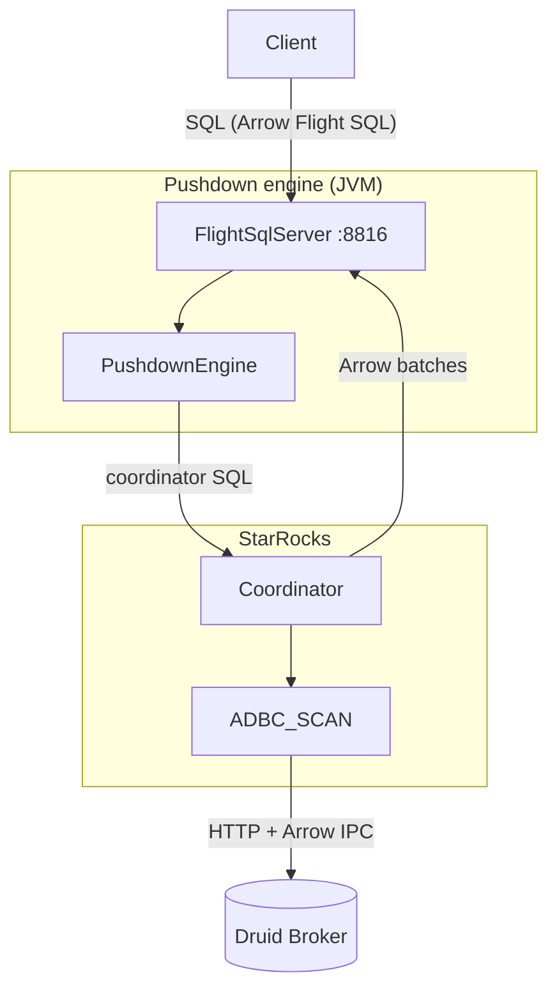

# Card format

A card is a short, exact description of one module, read by a person or an agent before
changing that module. It answers: what does this own, how do I call it, what happens
inside, what must stay true, what breaks, and what will surprise me. Nothing else.

## Front matter

```yaml
---
module: ingest                 # unique name; used in depends_on and the README table
paths: [src/ingest/**, scripts/load_*.py]   # files this card owns (globs, ** crosses dirs)
exclude: [src/ingest/legacy/**]             # optional
depends_on: [storage, config]  # modules this one calls — drives the README graph
entry_points: [ingest_file, IngestWorker]   # optional; else first 3 Interface symbols
order: 10                      # optional; README table order
---
```

Every source file belongs to exactly one card. `cards.py status` reports files no card
owns and files two cards own.

## Module boundary

One card per unit a developer changes as a whole: a package, a service, a layer.
Split when a card passes the line budget (`max_card_lines`, default 150) or its Flow
needs two unrelated main paths. Merge two cards when neither can be described without
the other's internals.

## Sections

Required: Purpose, Interface, Flow, Invariants, Failure modes, Dependencies. Optional:
State and data, Config, Gotchas, Tests, Decisions. Delete an optional section that has
no content; never fill one with "N/A". For a required section with no content, write
the fact: `None.` (Invariants of a pure formatter are none.)

| Section | Contains | Does not contain |
|---|---|---|
| Purpose | 1–2 sentences: what it owns, what it does not | history, motivation |
| Interface | public symbols other modules or users call: signature + contract | private helpers |
| Flow | numbered steps of the main path(s), each naming the function; ≤ 10 steps per path; a diagram when it says more (§Diagrams) | line-by-line narration |
| State and data | owned state, schema, where persisted, lifecycle | transient locals |
| Invariants | what must hold + where it is enforced, or "not enforced" | wishes |
| Failure modes | condition → behavior (raise, retry, return default, log and continue) | "handles errors" |
| Config | key, default, effect | keys the module never reads |
| Dependencies | uses / used by, by module name, with what for | third-party libraries unless central |
| Gotchas | surprises: ordering, hidden side effects, duplicated logic, intent ≠ behavior, known limits | general advice |
| Tests | covered paths and where; uncovered paths | test counts |

## Anchors

Every Interface row, invariant, failure mode and config key carries an anchor so a
reader can jump to the code and `cards.py check` can confirm it exists:

- `path/to/file.py::Symbol` or `path/to/file.py::Class.method` — preferred; survives edits.
- `path/to/file.py:120` — only when there is no symbol (a module-level constant block).
  Line anchors drift; `check` warns on them.

Paths are relative to the project root. An anchor that `check` cannot resolve is an
error, not a warning: a wrong pointer is worse than none.

## Diagrams

A diagram is a set of claims drawn instead of written. Each node line says "this
component exists, with this name". Each edge line says "this call, message or data flow
exists, in this direction". Each label says "with this protocol, payload or condition".
The judge gives every node and edge line a verdict like any other line, and `check`
lints each block. A diagram that cannot pass that is worse than none: it is the part of
a doc readers trust most and check least.

Which diagram, where:

| Where | Diagram | Shows |
|---|---|---|
| module Flow | `sequenceDiagram` | the main path across functions or modules, in call order; `alt` for branches that change the outcome |
| module Flow (topology, no order) | `flowchart LR` | which parts feed which |
| module State and data | `stateDiagram-v2` | lifecycle: every state, every transition with its trigger |
| module State and data (tables) | `erDiagram` | tables the module owns and their keys |
| system Runtime view | `flowchart TB` with one `subgraph` per process | what runs where; external systems; every cross-process edge labelled with the protocol |
| system Flows | `sequenceDiagram` per flow | each cross-module path, one diagram per flow |
| README | generated | module graph from `depends_on` (which `check` confirms against real imports) |

Rules (shared with `tech-doc`'s `references/style.md` §Mermaid diagrams, so a cards-based
doc and a long-form doc look alike):

- One diagram answers one question. Add one only where it says more than the numbered
  steps: branches, a protocol between processes, a lifecycle, more than about five steps.
  Never draw what one sentence says.
- ≤ 12 nodes in a module card, ≤ 18 in the system card (`max_diagram_nodes`). Over that,
  split: an overview plus one diagram per part or per flow.
- Names are the code's: node labels are module, class or function names as spelled in
  the code, or external systems as the Glossary names them. Not descriptions.
- Label every choice: every edge when a node has more than one outgoing edge, every
  state transition (`IDLE --> RUNNING : start() (pool.py::Pool.start)`), every message
  in a sequence (`api->>store: incr(key)`), every edge between processes (`HTTP + Arrow IPC`).
- One diagram line, one claim: one edge per line, so the judge can mark it alone.
  `A --> B --> C` on one line is two claims.
- No colours or styling (`style`, `classDef`): structure carries the meaning.
- Every node in a diagram also appears in the card's text or tables, with its anchor.
  The diagram adds the arrangement, not new components.

Getting it from the code instead of from memory:

- `cards.py graph <module>` prints the module's file-level import graph from static
  imports (Python, JS/TS, Java/Kotlin). Use it to find the real structure, then draw the
  diagram the reader needs: usually the main path, not every import.
- `cards.py graph` with no module prints the module graph from `depends_on`.
- For a sequence, follow the calls of one entry point through the code and write one
  message per call actually made. Branches that exist only in the prompt or a design
  doc do not go in.
- `cards.py check --render` parses each block with mermaid-cli (`mmdc`) when installed;
  without it, `check` still catches unknown types, unbalanced brackets, quotes and
  `subgraph`/`alt` … `end`, unlabelled choices and triggers, and oversize diagrams.

Example, system Runtime view, one subgraph per process and every cross-process edge
labelled with what the code sends:



## Precision rules

Every sentence states a fact about the code: a named subject, and a condition or value.

| Vague | Precise |
|---|---|
| "Handles errors gracefully." | "`fetch_page` retries a 5xx 3 times with 2 s backoff, then raises `FetchError`." |
| "Supports several formats." | "Reads CSV, Parquet and JSONL; any other suffix raises `ValueError`." |
| "Results are cached." | "`load_model` caches one model per `(name, device)` in a module dict; never evicted." |
| "Configurable timeout." | "`HTTP_TIMEOUT` (default 30 s) bounds each request, not the whole retry loop." |

- **Name the subject** as the code spells it. No "it", "the system" when two things could be meant.
- **Give the condition and the value**, with units. "Fast", "large", "often" are not values.
- **One claim per sentence**, present tense, active voice, ≈ 20 words max.
- **Unknown is stated, not hedged.** "The pool size comes from the driver default; the code does not set it." Not "probably".
- **No padding.** No preambles, summaries, transitions, or a second explanation of the
  same thing. Deletion test: if removing a sentence loses no fact, remove it.
- **Tables and lists over paragraphs.**
- **No vague or marketing words**: various, several (without a count), appropriately,
  properly, as needed, etc., robust, seamless, powerful, simply, easily, leverage.
  `check` warns on them.

## Document behavior, not intent

AI-generated code often differs from the prompt that produced it. The card records what
the code does. When the user's stated intent and the code disagree:

1. Write the code's behavior in the section.
2. Add a Gotcha: `Intended: <X> (source: user). Code: <Y> (`path::symbol`).`
3. Ask the user whether the code or the intent is wrong. Do not fix the code from the card
   skill unless asked.

Also record in Gotchas what AI coding tends to leave behind, when you find it:
duplicated helpers (`utils.parse_date` and `io.to_date` do the same thing), dead code
paths, swallowed exceptions (`except Exception: pass`), TODO stubs that return
constants, and config keys read in two places with different defaults.

## Rationale

`Design choice: <decision> — <reason> (source: user | commit abc123 | code comment).`
Only for decisions a reader would otherwise question. Never invent a reason: if the code
and history do not show it, ask the user or leave it out.

## System card (`_system.md`)

One per project. Sections: Summary (≤ 5 sentences), Flows (cross-module paths, each a
numbered list naming the module per step), Cross-module invariants, Glossary, Decisions,
Run and test (commands you ran). It never repeats a module card's internals; it names
the module and lets the README link to its card. The README section is built from the
sections listed in `config.json` → `readme_sections`.

## Good card, short

```markdown
---
module: ratelimit
paths: [src/api/ratelimit.py]
depends_on: [store]
---

# ratelimit

## Purpose

Limits requests per API key with a fixed window. It does not authenticate the key.

## Interface

| Symbol | Signature | Contract |
|---|---|---|
| `src/api/ratelimit.py::allow` | `allow(key: str, now: float) -> bool` | True if the key has quota left in the current window; increments the counter. |
| `src/api/ratelimit.py::RateLimitMiddleware` | ASGI middleware | Returns 429 with `Retry-After` when `allow` is False. |

## Flow

1. `RateLimitMiddleware.__call__` reads `X-Api-Key`; a missing key passes through unlimited.
2. `allow` computes `window = int(now // WINDOW_S)` and calls `store.incr(f"rl:{key}:{window}")`.
3. Counter > `LIMIT` → False.

## Invariants

- One counter per (key, window); TTL `2 * WINDOW_S` set on first increment (`src/api/ratelimit.py::allow`).

## Failure modes

| Condition | Behavior |
|---|---|
| store unreachable | `allow` returns True and logs `ratelimit.store_down` — fails open. |

## Config

| Key | Default | Effect |
|---|---|---|
| `RL_LIMIT` (`src/api/ratelimit.py::LIMIT`) | 100 | requests per window per key |
| `RL_WINDOW_S` (`src/api/ratelimit.py::WINDOW_S`) | 60 | window length, seconds |

## Dependencies

- Uses: store (counter increment with TTL)
- Used by: api (mounted in `src/api/app.py::create_app`)

## Gotchas

- Requests without `X-Api-Key` are never limited.
- Fixed window: a client can send 2 × `RL_LIMIT` across a window boundary.
```
