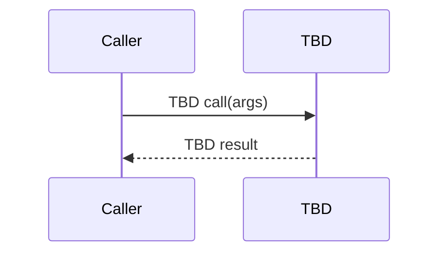

# TBD module name

## Purpose

TBD: one sentence — what this module owns. Second sentence only if needed: what it deliberately does not do.

## Interface

| Symbol | Signature | Contract |
|---|---|---|
| `TBD/path.py::Name` | `name(arg: T) -> R` | TBD: input → output; side effects; raises/returns on error |

## Flow

TBD: the main path as numbered steps, one action per step, each naming the function that does it.

1. TBD

TBD: add a diagram when the path branches, crosses modules, or has more than ~5 steps; delete this block otherwise. Every node and edge is a claim the judge checks. Starting point from the code: `cards.py graph <module>`.



## State and data

TBD: state this module owns (in memory, on disk, in a table), its shape and lifecycle. Delete the section if the module is stateless.

TBD: for a lifecycle or state machine, one stateDiagram; every transition names its trigger. Delete otherwise.

```mermaid
stateDiagram-v2
  [*] --> TBD
  TBD --> TBD2 : TBD trigger (path::symbol)
```

## Invariants

- TBD: what must stay true — enforced by `path::symbol`, or "not enforced".

## Failure modes

| Condition | Behavior |
|---|---|
| TBD | TBD |

## Config

| Key | Default | Effect |
|---|---|---|
| TBD | TBD | TBD |

## Dependencies

- Uses: TBD (module names, with what for)
- Used by: TBD

## Gotchas

- TBD: behavior a reader or an AI agent changing this code would not expect.

## Tests

TBD: what is covered and where; what is not covered.
