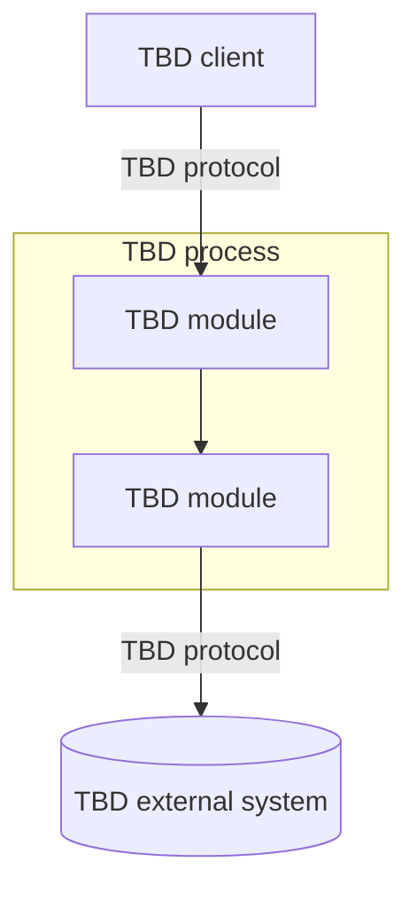
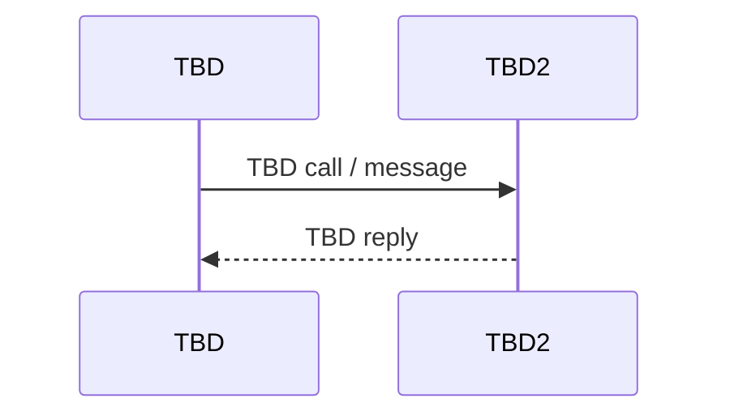

# System

## Summary

TBD: at most five sentences — what the system does, for whom, its main parts by module name, and how it runs (process, service, library, CLI).

## Runtime view

TBD: one flowchart of what runs where: processes as subgraphs, modules inside them, external systems as nodes, every edge labelled with the protocol or payload the code uses (`SQL (Arrow Flight SQL)`, `HTTP + JSON`). ≤ 18 nodes.



## Flows

### TBD: flow name (e.g. "Ingest a file")

1. TBD: `module` — what it does at this step.



## Cross-module invariants

- TBD: rules that span modules, and the module that enforces each.

## Glossary

| Term | Meaning in this code |
|---|---|
| TBD | TBD |

## Decisions

- Design choice: TBD — reason (source: user, commit, or code comment).

## Run and test

```sh
TBD: commands verified by running them
```
